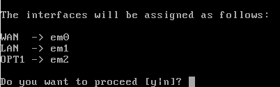
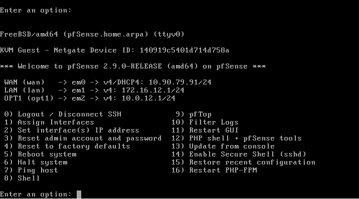
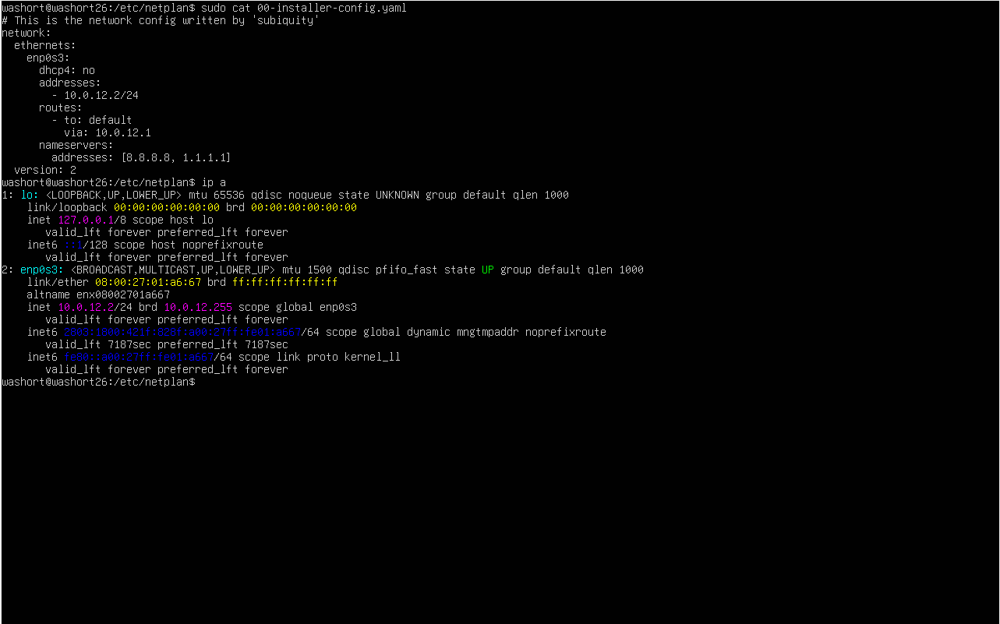
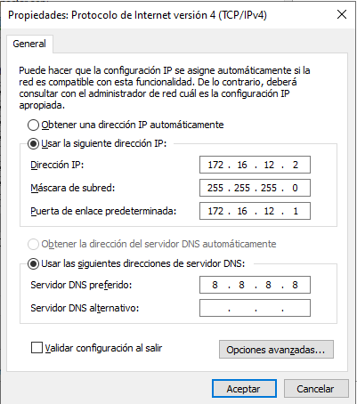

# Secure Infrastructure Lab (Secure-infra-lab)


## Overview

This project simulates a secure enterprise network architecture, implementing strict segmentation between the WAN, DMZ, and LAN zones using a pfSense firewall/router. The lab demonstrates traffic control, firewall policies, network subnets, and hosts a containerized web application (404Shop) inside the DMZ zone behind a reverse proxy.

## Architecture & topology

* **Hypervisor:** Oracle VirtualBox
* **Firewall/Router:** pfSense
* **DMZ Server:** Ubuntu Server (Hosting 404Shop + Nginx Proxy)
* **Internal LAN Endpoint:** Windows Server

#### VM 1: pfSense Router / Firewall

* **Adapter 1 (WAN):** Bridged Adapter (Internet access / external simulation)
* **Adapter 2 (LAN):** Internal Network - `LAN-Net` (`172.16.12.1/24`)
* **Adapter 3 (DMZ):** Internal Network - `DMZ-Net` (`10.0.12.1/24`)

#### VM 2: Ubuntu Server (DMZ Zone)

* **Network Adapter:** Internal Network - `DMZ-Net` (`10.0.12.2/24`, Gateway: `10.0.12.1`)
* **Software Stack:** Docker, Docker Compose, 404Shop, Nginx Reverse Proxy.

#### VM 3: Windows Server (Internal LAN Endpoint)

* **Network Adapter:** Internal Network - `LAN-Net` (`172.16.12.2/24`, Gateway: `172.16.12.1`)
* **Purpose:** Simulates an internal corporate workstation/server requiring secure access isolation.

---


## Step-by-Step Implementation Guide

If you want to replicate this secure lab environment in VirtualBox, follow these deployment steps:

### 1. VirtualBox Network Setup

Before creating the VMs, make sure your VirtualBox environment is ready. You will need to configure two Internal Networks in your VirtualBox manager:

* `LAN-Net`
* `DMZ-Net`

### 2. Setting up pfSense (Firewall / Router)

1. Download the pfSense ISO and create a new FreeBSD (64-bit) Virtual Machine.
2. Configure the 3 network adapters as specified in the architecture section:
* **Adapter 1:** Bridged Adapter (WAN)
* **Adapter 2:** Internal Network (`LAN-Net`)
* **Adapter 3:** Internal Network (`DMZ-Net`)
3. Boot the VM and complete the initial pfSense console setup:
* Assign the interfaces (`wan`, `lan`, `opt1` for DMZ).
* Set IP addresses for LAN (`172.16.12.1/24`) and DMZ (`10.0.12.1/24`).
* Enable DHCP on the LAN interface if desired.

### 3. Setting up Ubuntu Server (DMZ)

1. Install Ubuntu Server on a VM connected *exclusively* to the `DMZ-Net` internal network.
2. Configure a static IP address (`10.0.12.2/24`) pointing to the DMZ gateway (`10.0.12.1`).
3. Enable SSH for remote administration and install Docker:

```bash
sudo apt update && sudo apt install -y openssh-server docker.io docker-compose
sudo systemctl enable --now docker
```

4. Clone and deploy your 404Shop project along with nginx reverse proxy using docker compose

### 4. Setting up windows server (Internal LAN)

1. Install windows server (Desktop experience) on a VM connected exclusively to the LAN-Net internal network

2. configure its static IP (`172.16.12.2/24`) and gateway (`172.16.12.1`)

3.  Verify connectivity toward the DMZ and WAN through the pfsense firewall.

## pfsense config

Once you are in pfSense, first you have to assign interfaces (Option 1):



The interfaces will typically be assigned as follows:

- **WAN** -> `em0`
- **LAN** -> `em1`
- **OPT1 (DMZ)** -> `em2`

Then set the interfaces IP addresses (Option 2):

- **WAN:** IPv4 via DHCP
- **LAN:** IPv4 `172.16.12.1/24` (without DHCP)
- **DMZ (Opt1):** IPv4 `10.0.12.1/24` (without DHCP)

The final console summary configuration must look like this:



## Ubuntu server config

Now, in ubuntu server, go to edit /etc/netplan/00-installer-config.yaml

```
sudo nano /etc/netplan/00-installer-config.yaml
```

set the network interface with the static IP of the DMZ `10.0.12.2/24` and point the traffic to the gateway of pfsense (`10.0.12.1`) 

```
network:
  version: 2
  ethernets:
    enp0s3: # <--- put here the real name of your network card of ubuntu (ip a)
      dhcp4: no
      addresses:
        - 10.0.12.2/24
      routes:
        - to: default
          via: 10.0.12.1
      nameservers:
        addresses: [8.8.8.8, 1.1.1.1]
```

like this:


## Windows Server (LAN Endpoint)

to config static IP in windows server, press WIn+R and type `ncpa.cpl` and press enter, in the new window, press right click over your LAN network adapter and select properties, select internet protocol version 4 (TCP/IPv4) and click in properties, ans set the next values



click in accept.

## Installing and validating the connectivity

Lets set up the web server in the DMZ and check that the subnets can comunicate correctly across the router/firewall

**In ubuntu server (DMZ):** open the terminal and install Nginx to simulate a active web service

sudo apt update && sudo apt install -y nginx
sudo systemctl enable --now nginx 

**In windows server (LAN Endpoint):** open powershell or CMD and make a ping to the gateway of the DMZ and the IP of the server ubuntu to verify the conectivity of layer 3:

```
ping 10.0.12.2
```

then open your web browser an go to `http://10.0.12.2`

if you see the welcome page "Welcome to nginx!" that means everything is working. The bassic routing between the LAN network (172.16.12.0/24) and the DMZ network (10.0.12.0/24) across the router is successfully working.


